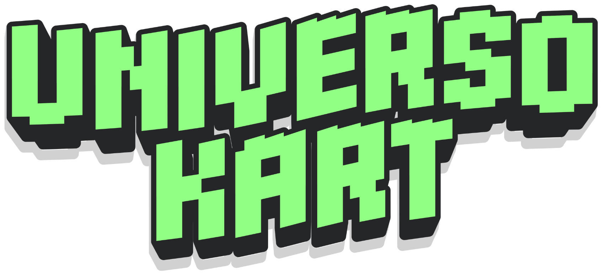

<div align="center">



# UNIVERSO KART

**Kart arcade 3D com ETs, tela dividida para 2 jogadores e muito drift, ambientado no campus da UNIFEOB.**


-ff69b4)


*Um projeto da **Raccons Games** para a **UNIFEOB**.*

</div>

---

## Sobre o jogo

Em UNIVERSO KART, dois ETs disputam voltas num circuito que passa por prédios, túneis e rampas do campus.
Pilote em **tela dividida**, derrape para ganhar mini-turbos, pegue **caixas "?"** com itens e enfrente
**4 corredores de IA**. No fim, o vencedor comemora e os demais lamentam antes de aparecer o resultado.

Quase tudo é **gerado por código**: pista, karts, personagens, shaders, música e efeitos sonoros.
O jogo carrega poucos arquivos externos além dos modelos dos personagens e das logos.

## Destaques

- **Corrida 2P em tela dividida**, com um controle por jogador (ou teclado) e fallback automático para teclado.
- **6 karts por corrida**: 2 jogadores e 4 NPCs. Eles pegam e usam itens, desviam de bananas, fazem drift e miram as faixas de turbo.
- **Drift com mini-turbo em 3 níveis**: as fagulhas vão de azul a laranja e a rosa, e o turbo dura 0,7 s, 1,2 s ou 1,8 s.
- **Largada com boost**: segure o acelerador desde o "3" para sair com turbo, chama, tremor de câmera e vibração do controle.
- **5 itens**: Escudo, Foguete (reto, 3 s), Banana, Turbo e o **Pulso UNIFEOB**, que só sai para quem está atrás.
- **Dois ETs escolháveis**, o *Visitante do Universo* (verde) e o *Turista do Universo* (rosa, com cílios e laço), com 8 cores de traje.
- **Cinemática de fim de corrida** com poses de vitória (sinal de paz, estrelinhas ou corações) e de derrota.
- **Trilha e efeitos sintetizados em código** (EDM moderna e alegre), sem arquivos de áudio.
- **Shaders próprios** para concreto, prédios, terreno, olhos, capacete, traje, caixas de item e linhas de velocidade.

## Controles

| Ação | Controle Xbox | Teclado P1 | Teclado P2 |
|---|---|---|---|
| Direção | Analógico esquerdo | A / D | ← / → |
| Acelerar | RT ou A | W | ↑ |
| Frear / ré | LT | S | ↓ |
| Drift | B ou RB | Espaço ou Shift esquerdo | Ctrl direito ou Numpad 0 |
| Usar item | X ou LB | E ou Q | Enter do numérico, Shift direito ou Numpad 1 |
| Menus: escolher / confirmar / voltar | ◀ ▶ / A / B | A D / Espaço, E ou Enter / Q | ← → / Enter do numérico / Backspace |

O 1º controle conectado vira o P1 e o 2º vira o P2. Sem controle, o jogador usa o teclado.

## Itens

| Item | O que faz |
|---|---|
| **Escudo** | Bolha por 6 s que anula banana e foguete. |
| **Foguete** | Voa reto por 3 s, colado ao chão. Quem for atingido fica parado por 2 s. |
| **Banana** | Fica na pista atrás do kart. Quem passar por cima rodopia e perde a velocidade. |
| **Turbo** | Aceleração forte por 1,5 s. |
| **Pulso UNIFEOB** | Eletriza todos os karts à frente, que ficam 2,6 s mais lentos e sem turbo. |

## Como rodar

**Requisito:** [Godot 4.7.2](https://godotengine.org/download) (versão *standard*, sem .NET).

1. Clone o repositório:
   ```bash
   git clone https://github.com/henrique-molinari/universo-kart.git
   ```
2. Abra o Godot, clique em **Importar** e selecione o `project.godot`. A primeira importação pode demorar alguns minutos.
3. Conecte os controles (opcional) e pressione **F5**.

Fluxo do jogo: **Splash** → **Título** → **Seleção de ET e cor** → **Corrida** → **Comemoração** → **Resultado**.

Para gerar um `.exe`, use **Projeto → Exportar → Windows Desktop**. O preset já está em `export_presets.cfg`.
O executável não faz parte do repositório porque passa de 100 MB.

## Testes automáticos

Dois testes rodam sem controle e sem janela:

```bash
godot --headless --fixed-fps 60 --path . res://tools/validate/validate_gameplay.tscn
godot --headless --fixed-fps 60 --path . res://tools/validate/validate_flow.tscn
```

- **Gameplay** simula uma corrida completa com 6 karts e 77 verificações: voltas, muretas, os 5 itens, NPCs, largada com boost, níveis de drift, ETs e comemoração.
- **Fluxo de telas** (27 verificações) percorre splash, título, seleção, corrida, comemoração e resultado com entrada simulada.

Há também uma ferramenta de capturas de tela reais em [tools/capture](tools/capture/README.md).
Ela **não** funciona em `--headless`.

## Estrutura do projeto

```
assets/        branding, personagens (.glb), shaders, materiais, fontes e ambiente
scenes/        splash, título, seleção, corrida e a pista (campus_circuit)
scripts/
  core/        estado do jogo, entrada, áudio e síntese, paleta, qualidade de render
  kart/        kart, câmera, ETs, pilotos e IK das mãos no volante
  items/       caixas, foguete, banana, escudo e pulso
  race/        lógica da corrida, HUD e ícones de item
  track/       geração da malha da pista
  scenery/     prédios e túneis
  ui/          splash, título e seleção
tools/         testes (validate), capturas (capture) e utilitários de modelagem
```

## Tecnologias

- **Godot 4.7** com renderização 3D e GDScript
- Áudio sintetizado em tempo de execução
- Shaders em GDShader
- Malhas e pista geradas proceduralmente

## Créditos

Desenvolvido pela **Raccons Games** para a **UNIFEOB**.
As logos e marcas em `assets/branding` pertencem aos seus respectivos titulares.

## Mais detalhes

O roteiro completo de testes manuais está em [COMO_TESTAR.md](COMO_TESTAR.md).
